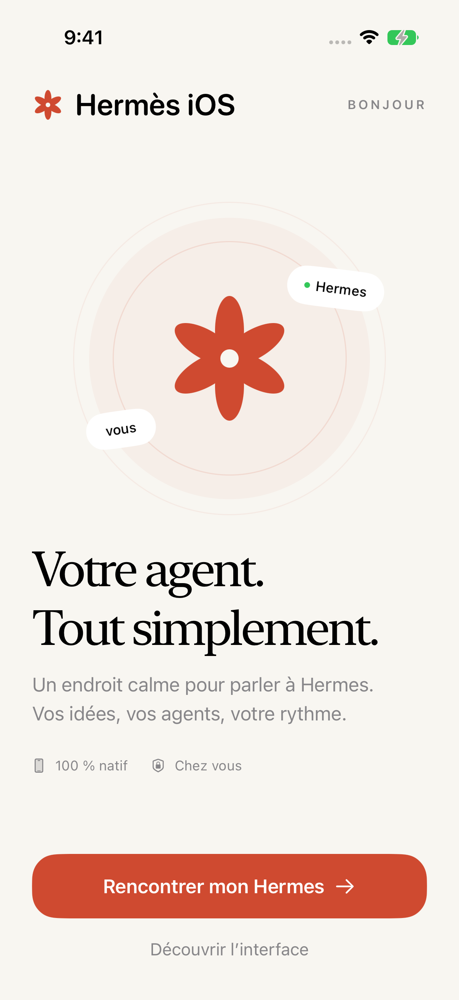
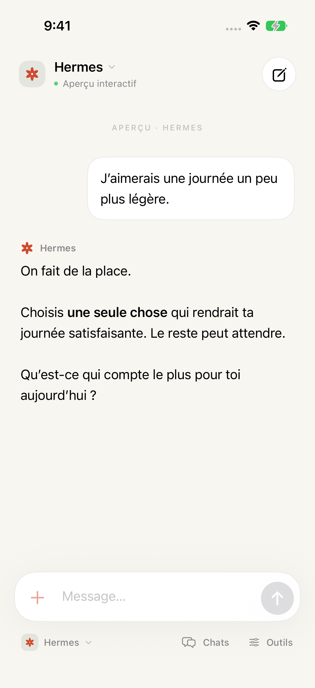
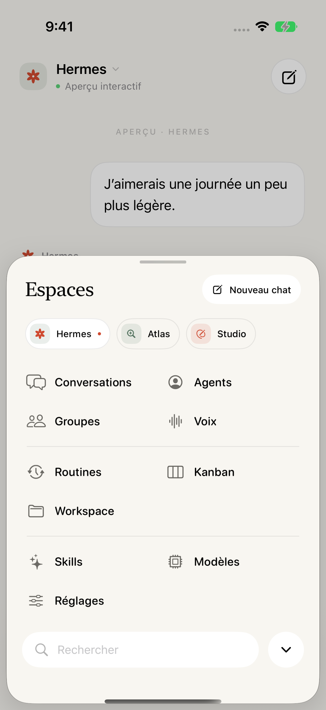
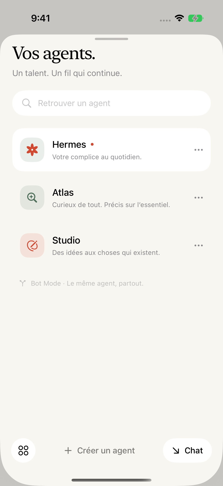

# Hermès iOS

**A quiet, native iOS home for your Hermes agent.**

Hermès iOS connects directly to [Hermes Agent](https://github.com/NousResearch/hermes-agent) by Nous Research. Your agent stays on your server; Hermès iOS gives it a small, thoughtful interface on your iPhone. Built with SwiftUI and Apple's networking frameworks. Native WebRTC powers GPT-Live; there is no hosted relay, analytics, or Hermès iOS account.

<p>
  
  
  
  
</p>

## What works

- Direct connection to the official `hermes serve` backend, including Tailscale IPs, MagicDNS, HTTPS and reverse-proxy path prefixes.
- Native password authentication, session credentials in the iOS Keychain, fresh single-use WebSocket tickets, and the existing legacy session-token path.
- Streaming chat, Markdown and code blocks, copy/share, expandable tool activity, cancellation, approvals, clarification and secret input. Send errors stay next to the composer; changing the conversation's workspace uses a brief confirmation banner.
- Thumb-first navigation: send/stop sits beside the text, with attachments, profile, history, tools and voice in a second row inside the composer. The header names the conversation. No bottom tab bar.
- A quick agent picker with pinned and recent profiles, gateway context and unread indicators. One Menu sheet holds the current agent, up to three editable shortcuts, Work, My agents and App sections, and a search across tools and agent settings.
- Compact conversation history with All, Unread and Archives filters. Local reading markers survive restarts and stay isolated by gateway and profile; opening a chat is distinct from an agent actually working or waiting for approval.
- Cached conversations and per-chat drafts stay visible while reconnecting. Ordered replay deduplicates missing events. Uncertain sends are never automatically repeated.
- Multiple saved gateways and isolated Hermes profiles.
- Bot roster, existing canonical **Bot Chats**, profile creation/cloning, description and SOUL editing, and `@profile` suggestions.
- Native routines: readable daily, weekday, weekly and hourly schedules, an advanced schedule field, next-run times and direct access to the native conversation for a completed run. Hermes owns scheduling and execution; new routines deliver to the owning Bot Chat.
- Permissions explain when the agent asks for approval, identify the affected profile and keep detailed rules in advanced settings. Every option still comes from Hermes’ configuration schema.
- Desktop-parity agent settings for any profile, without leaving the open chat: model (main, fallbacks, auxiliary tasks including the fast voice route, MoA), conversation, workspace, safety, browser, memory, voice, advanced and every other schema field, with native toggles, pickers, list editors, defaults and search. Keys and credentials (write-only, stored in the profile’s `.env` on the server), providers and custom endpoints, messaging platforms and extensions have their own pages. Agent settings are grouped as Essentials, Connections and Advanced; « Gérer et créer » manages every profile, and the menu switches to other saved servers.
- Native hosted groups with 2–6 profiles on the same gateway, attributed messages, durable cursor replay, idempotent retry and stop.
- Skills: browse installed skills, read their instructions, enable/disable per profile.
- Models: browse configured providers and choose the default for new sessions, respecting Hermes’ native confirmation prompts.
- Workspace: browse native projects and their folders.
- Kanban: switch boards, filter by status, inspect tasks/results/comments, and add ideas to triage with native idempotency keys.
- Attach photos or files from the composer’s + menu. Up to four files, 10 MiB each; photo-library images are resized locally before upload through native Hermes RPCs.
- Automatic voice conversations: open voice and speak naturally, hear the agent through its configured TTS provider, and continue without holding or tapping a send button. Live transcription shows your words while you speak (when the profile streams STT), the reply starts speaking during generation with chunked-PCM providers, and you can interrupt the agent while it thinks or speaks. A mute button and an end-call button stay within thumb reach. Written drafts and attachments remain separate.
- A warm animated voice presence, clear listening/thinking/speaking states and an expandable transcript. The small Canvas animation is isolated from streaming text, uses a 24 fps clock and respects Reduce Motion.
- Light/dark appearance, native controls, VoiceOver labels and an offline interactive preview.

The first UI is in French. Contributions for localization are welcome.

Before the addition of WebRTC, the last measured installed device build was: approximately **6.3 MB**, unpacked and development-signed. [Validation results](docs/VALIDATION.md).

## Run

Requirements: macOS, Xcode 16 or later with a matching iOS simulator runtime, and iOS 17 or later on device. Development validation currently uses Xcode 27 / iOS 27 Simulator. The Xcode project is checked in; XcodeGen is only needed when changing its structure.

1. Clone this repository and open `HermesIOS.xcodeproj`.
2. Select the **HermesIOS** scheme and an iPhone simulator. Run.
3. Choose **Découvrir l’interface** for the offline preview, or connect your Hermes server using the [connection guide](docs/CONNECTING.md).

For an actual iPhone, select your development team in Signing & Capabilities and use your own bundle identifier. There is no App Store or TestFlight release yet.

```sh
swift test

# If you change project.yml or add source files:
brew install xcodegen
xcodegen generate

# Choose an available simulator from xcrun simctl list devices available:
xcodebuild -scheme HermesIOS -destination 'platform=iOS Simulator,name=iPhone 17 Pro' test
```

Keep simulator signing enabled when testing authentication: the Keychain needs the application entitlement. Building with `CODE_SIGNING_ALLOWED=NO` is suitable only for a compile check.

## Hermes compatibility

Validated on October 13, 2026 against Hermes **0.21.7**, commit [`71d34ba`](https://github.com/NousResearch/hermes-agent/commit/71d34bad1045610252eda02ee79549436896e784), with every RPC, event and server request checked against its typed contract catalog. Hermes 0.21.7 requires clients to declare `client.capabilities`; earlier builds of this app did not, so approvals and questions never reached them. Build 15 added native management and bidirectional interactive requests against Hermes **0.21.3**, commit `9326d9c`, on September 16, 2026. The initial client was researched and integration-tested against Hermes **0.21.2**, commit [`b7b35a8`](https://github.com/NousResearch/hermes-agent/commit/b7b35a84b7fbe1aa2e223a6ce726a2471300d0a4), on September 12, 2026. Hermes evolves rapidly. Hermès iOS uses native capability checks for Bot Mode, profile-scoped routines and hosted groups; an old or incompatible backend may need updating.

Hermès iOS uses `/api/ws`, Hermes' JSON-RPC methods and its authenticated REST routes. Kanban requires the native Kanban plugin on the server. It does **not** reimplement Hermes behind an OpenAI-compatible chat proxy. Memory, prompts, tools, profiles, permissions, scheduled work and durable conversation history remain owned by Hermes. [Protocol research and exact methods](docs/HERMES_PROTOCOL.md).

## Honest boundaries

This is an early **0.1.0** client. Build 15 adds profile permissions/configuration, toolset and MCP management, Bot display names/pinning/hiding/deletion, history search/pagination/archives, conversation branches/compression and native slash routing. Cron supports editing, free-form schedules, triggering, deletion and run history. Kanban supports editing, assignment, status and comments. Skills support creation/editing and hub installation/update/uninstall; local/bundled skills can be disabled. Workspace supports project creation/editing, selecting the conversation directory, and text file browsing/editing. Profile memory files are editable. Groups support pending approvals, explicit retries, renaming and disbanding.

Voice uses Hermes’ native relay routes: `/api/audio/transcribe-stream` (live STT, with `/api/audio/transcribe` as fallback) and `/api/audio/speak-stream` (with `/api/audio/speak` as fallback). The server controls transcription, sentence splitting, Markdown cleanup, provider and voice; spoken turns use Hermes’ fast `voice_chat` route. Audio begins during generation with OpenAI or ElevenLabs; Edge speaks per sentence. One duplex Apple audio engine keeps the microphone available during playback, with voice processing enabled. When the profile permits interruption, detected speech stops playback and preserves its onset before the next turn. GPT-Live profiles use native WebRTC. The voice menu’s “GPT-Live · Stone · français” choice enables that mode and Stone for the selected server profile; standard voice remains available per call. The OpenAI key stays on the Hermes server. Speaker echo cancellation, Bluetooth routes and microphone behavior still need hands-on iPhone validation; the simulator fixture does not establish hardware audio quality.

OAuth/Nous Portal browser sign-in, message editing/regeneration, rich tool-result panels, Bot avatars/mentions/sections, unified multi-server rosters and cross-gateway group administration remain outside this build. Advanced Kanban worker controls and current-session model/provider onboarding are not exposed as dedicated screens. Search is limited by the native endpoint to 100 matching results; ordinary history is paginated. Configuration fields depend on the server’s schema. Remote file edits check for concurrent changes before saving, but the native API does not provide an atomic compare-and-swap. The app preserves the server’s permission and validation boundaries. See the [feature matrix](docs/FEATURES.md).

Unread markers describe activity observed by this iPhone; they are not server-synchronized read receipts. The initial history stays quiet, and message counts take precedence over preview text and refresh timestamps. The expandable tool summary keeps at most 40 steps from the live/replayed turn; it is not a persisted execution log or a rich tool-result viewer.

iOS suspends network work in the background. The agent keeps working on the server; Hermès iOS reconnects on return. Hermes' replay ring is finite and its transcript snapshots do not carry an atomic event cursor. Normal reconnects replay exactly; after a ring overflow, Hermès iOS rebases from history/in-flight text, retaining the known partial answer when overlap cannot be proven until the authoritative final answer arrives. “Invisible sync” is a UX objective, not a promise that an offline phone receives live tokens. See [architecture](docs/ARCHITECTURE.md).

## Contribute

Read [CONTRIBUTING.md](CONTRIBUTING.md) and [the testing guide](docs/TESTING.md). Protocol changes should include a behavioral test and evidence from the official Hermes implementation. Keep the app small. Don't add a replacement backend, a private sync service, or provider credentials to the client.

MIT licensed. Hermès iOS is an independent community project, not an official Nous Research product. Hermes Agent retains its own license and branding.

## iPhone notifications

Optional APNs support and a native Hermes observer extension are included. A notification opens its exact saved server, profile and conversation, including Bot Chat messages produced by cron. Actual delivery requires an Apple push key, push-capable signing and server setup; it is not enabled by installing the iOS client alone. See [notification setup and validation](docs/NOTIFICATIONS.md).
